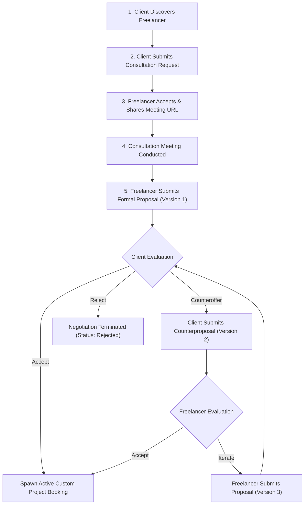
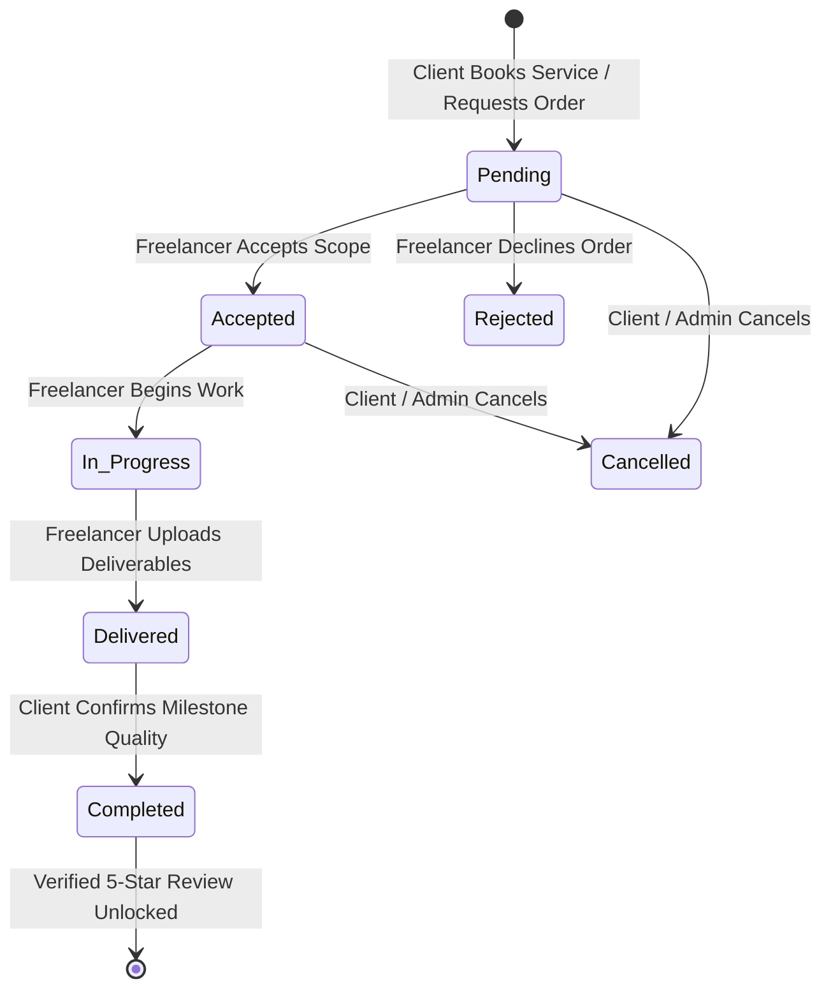
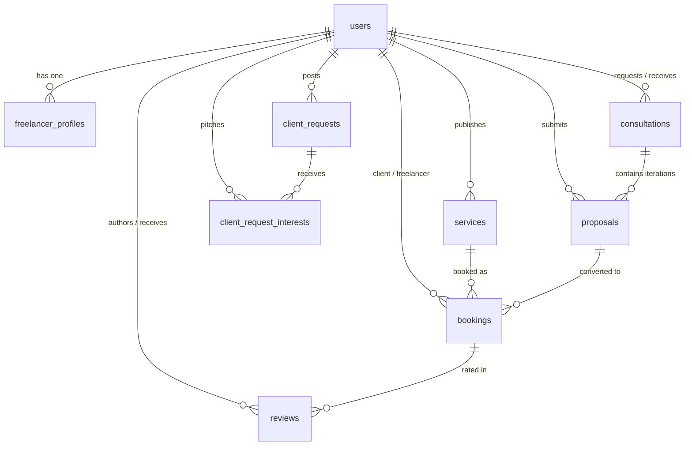

# FreelanceConnect – Dual-Model Freelancer Marketplace Platform

[](https://www.python.org/)
[](https://flask.palletsprojects.com/)
[](https://www.sqlite.org/)
[](https://getbootstrap.com/)
[](https://fontawesome.com/)
[](test_app.py)
[](LICENSE)
[](requirements.txt)

> A modern, choice-driven freelance marketplace that connects clients with verified professionals through **two distinct hiring models** (alongside an open client requirement board), eliminating the race-to-the-bottom bidding wars found in conventional freelance platforms.

---

## 📑 Table of Contents
1. [Platform Overview & The Freelance Trilemma](#-platform-overview--the-freelance-trilemma)
2. [Core Hiring Architecture](#-core-hiring-architecture)
   - [Model A: Consultation-Based Custom Work](#1-model-a--consultation-based-project-hiring-custom-work)
   - [Model B: Fixed-Price Instant Packages](#2-model-b--fixed-price-service-booking-instant-packages)
   - [Model C: Client Requirement Board](#3-model-c--client-project-requirements-board-open-briefs)
3. [Key Architectural & UX Highlights](#-key-architectural--ux-highlights)
4. [System Architecture & Visual Workflows](#-system-architecture--visual-workflows)
   - [Model A Negotiation Sequence](#model-a-negotiation-flowchart)
   - [5-Stage Project Delivery Lifecycle](#5-stage-project-delivery-state-machine)
   - [Entity Relationship Diagram (ERD)](#entity-relationship-diagram-erd)
5. [Database Architecture & Schema Reference](#-database-architecture--schema-reference)
6. [Security, RBAC & Data Integrity](#-security-rbac--data-integrity)
7. [Pre-Seeded Demo Accounts](#-pre-seeded-demo-accounts)
8. [Step-by-Step Evaluation Walkthrough](#-step-by-step-evaluation-walkthrough)
   - [Scenario 1: Custom Project Hiring & Negotiation (Model A)](#scenario-1-custom-project-hiring--negotiation-model-a)
   - [Scenario 2: Fixed-Price Package Booking & Review (Model B)](#scenario-2-fixed-price-service-booking--review-model-b)
   - [Scenario 3: Requirements Board & Talent Pitching (Model C)](#scenario-3-open-project-requirements-board-model-c)
   - [Scenario 4: Platform Governance & Moderation (Admin)](#scenario-4-platform-governance--kpi-oversight-admin)
9. [API & Route Catalog](#-api--route-catalog)
10. [Quick Start & Installation](#-quick-start--installation)
11. [Automated Testing Suite](#-automated-testing-suite)
12. [Project File Structure](#-project-file-structure)
13. [Future Roadmap](#-future-roadmap)

---

## 💡 Platform Overview & The Freelance Trilemma

Conventional freelance platforms force professionals into destructive **bidding wars** where price takes precedence over competence, while clients suffer from cost ambiguity, scope creep, and unresponsive contractors.

**FreelanceConnect** solves this trilemma by introducing a **dual-model marketplace** that balances custom engineering with fixed-scope velocity:

```text
┌──────────────────────────────────────────────────────────────────────────────────┐
│                             FREELANCECONNECT PLATFORM                            │
├────────────────────────────────────────┬─────────────────────────────────────────┤
│    MODEL A: CUSTOM CONSULTATION        │    MODEL B: FIXED-PRICE PACKAGES        │
│    • Exploratory video meeting         │    • Upfront deliverables & pricing     │
│    • Multi-version proposal workflow   │    • 1-click booking checkout           │
│    • Agreed scope prevents creep       │    • 5-stage milestone tracking         │
├────────────────────────────────────────┴─────────────────────────────────────────┤
│              MODEL C: OPEN CLIENT REQUIREMENT BOARD (NON-BIDDING PITCHES)        │
└──────────────────────────────────────────────────────────────────────────────────┘
```

---

## 🌟 Core Hiring Architecture

### 1. Model A — Consultation-Based Project Hiring (Custom Work)
**Discuss &rarr; Negotiate &rarr; Agree &rarr; Hire**
* **Target Projects**: E-commerce stores, SaaS architectures, bespoke mobile applications, and enterprise systems with evolving technical requirements.
* **Operational Flow**:
  1. **Discovery & Request**: The client browses verified freelancers and books a consultation slot (Online video or In-person) with target objectives.
  2. **Freelancer Acceptance**: The freelancer accepts the meeting and shares an external meeting link (Google Meet, Zoom, Microsoft Teams).
  3. **Formal Proposal Submission**: Following the meeting, the freelancer drafts a formal **Version 1 Proposal** detailing scope, deliverables, turnaround days, and total budget.
  4. **Multi-Version Negotiation Engine**: The client can accept immediately or submit a structured **Counterproposal (Version 2)** with modified scope or timeline.
  5. **Mutual Agreement & Automatic Conversion**: As soon as either party accepts the latest proposal version, the system marks earlier versions as `Superseded` and auto-provisions an active **Custom Project Engagement** in both dashboards with status `In Progress`.

### 2. Model B — Fixed-Price Service Booking (Instant Packages)
**Select &rarr; Book &rarr; Confirm &rarr; Deliver**
* **Target Projects**: Brand identity kits, vector logos, responsive landing pages, technical blog articles, smart contract audits, and well-defined tasks.
* **Operational Flow**:
  1. **Predefined Deliverables**: Freelancers publish packages with transparent fixed pricing, estimated delivery days, and clear checklists.
  2. **Instant Checkout**: The client reviews the package, inputs brand requirements/assets and preferred start date, and submits the booking.
  3. **Order Lifecycle Execution**: The freelancer reviews requirements, transitions the project from `Pending` &rarr; `Accepted` &rarr; `In Progress`, and provides progress notes.
  4. **Deliverable Handover**: Freelancer uploads final deliverables and work notes, moving status to `Delivered`.
  5. **Completion Confirmation & Rating**: The client reviews deliverables, marks `Completed`, and unlocks the verified **5-Star Rating & Review Form**.

### 3. Model C — Client Project Requirements Board (Open Briefs)
**Post Brief &rarr; Review Pitches &rarr; Invite &rarr; Consult**
* **Target Projects**: Projects where clients seek multiple expert perspectives before initiating a consultation.
* **Operational Flow**:
  1. Clients publish open briefs with category, required skill tags, budget brackets (min/max), and delivery deadlines.
  2. Freelancers browse active requirements and submit an **Expression of Interest** accompanied by a tailored qualitative pitch (no downward bidding).
  3. Clients review candidate profiles, hourly rates, and pitch messages, then click **Invite to Consultation** to route the conversation into Model A.

---

## ⚡ Key Architectural & UX Highlights

* **Zero-Build Architecture**: Runs natively on standard Python 3.10+ without Node.js, npm, or frontend bundlers. Modern Bootstrap 5.3 and Font Awesome 6.5 are consumed through high-availability CDNs.
* **1,000+ Skills Interactive Taxonomy**: Indexed directory spanning 12 industry verticals with an interactive modal and client-side instant search API (`/api/skills`).
* **3D Center-Stage Project Carousel**: Landing page showcases high-impact portfolio completions with focal center zoom, arrow navigation, and 10-second automatic rotation.
* **Audit-Audited Proposal Versioning**: Prevents scope disputes by maintaining an immutable history of iterations (`Pending`, `Accepted`, `Rejected`, `Superseded`).
* **5-Stage Order Progress Stepper**: Interactive visual timeline tracking orders from `Pending` through `Completed` with role-based actions.
* **Completion-Gated Review Integrity**: Reviews can strictly only be submitted after client confirmation of completion (`booking_id` foreign key uniqueness constraint).
* **1-Click Demo Quick-Login Switcher**: Built-in credential autofill on the login screen for instantaneous role swapping during demonstrations.

---

## 📊 System Architecture & Visual Workflows

### Model A Negotiation Flowchart



### 5-Stage Project Delivery State Machine



### Entity Relationship Diagram (ERD)



---

## 🗄️ Database Architecture & Schema Reference

FreelanceConnect uses an enterprise-grade SQLite3 relational database (`database/freelanceconnect.db`) with `PRAGMA foreign_keys = ON;` and `sqlite3.Row` factory.

| # | Table Name | Purpose | Key Columns & Constraints |
| :--- | :--- | :--- | :--- |
| **1** | `users` | Platform authentication and account management | `user_id` (PK), `email` (UNIQUE), `password_hash`, `role` (`client`, `freelancer`, `admin`), `status` (`active`, `suspended`) |
| **2** | `freelancer_profiles` | Professional profiles, bios, rates, and rating aggregates | `profile_id` (PK), `user_id` (FK &rarr; `users`), `headline`, `skills`, `category`, `hourly_rate`, `availability` (`Available`, `Busy`), `rating_avg`, `rating_count` |
| **3** | `services` | Fixed-price predefined marketplace packages | `service_id` (PK), `freelancer_id` (FK &rarr; `users`), `title`, `category`, `price`, `delivery_days`, `deliverables`, `status` (`Active`, `Inactive`) |
| **4** | `consultations` | Meeting requests and scheduling for Model A | `consultation_id` (PK), `client_id`, `freelancer_id`, `meeting_type` (`Online`, `In-person`), `meeting_link`, `status` (`Pending`, `Accepted`, `Rejected`, `Reschedule Requested`, `Completed`, `Cancelled`) |
| **5** | `client_requests` | Open project requirements board for Model C | `request_id` (PK), `client_id` (FK &rarr; `users`), `title`, `category`, `required_skills`, `budget_min`, `budget_max`, `deadline`, `status` (`Open`, `Closed`) |
| **6** | `client_request_interests`| Candidate pitch submissions for requirements | `interest_id` (PK), `request_id` (FK), `freelancer_id` (FK), `message`, `status` (`Interested`, `Invited`, `Declined`), UNIQUE(`request_id`, `freelancer_id`) |
| **7** | `proposals` | Multi-version negotiation iterations for Model A | `proposal_id` (PK), `consultation_id` (FK), `sender_id` (FK), `proposed_amount`, `delivery_days`, `scope`, `version`, `status` (`Pending`, `Accepted`, `Rejected`, `Superseded`) |
| **8** | `bookings` | Unified order execution tracker (Fixed & Custom) | `booking_id` (PK), `client_id`, `freelancer_id`, `service_id` (FK, NULLable), `proposal_id` (FK, NULLable), `booking_type` (`Fixed`, `Custom`), `agreed_amount`, `status` (`Pending`, `Accepted`, `In Progress`, `Delivered`, `Completed`, `Rejected`, `Cancelled`) |
| **9** | `reviews` | Completion-gated verified client reviews | `review_id` (PK), `booking_id` (FK, UNIQUE), `client_id` (FK), `freelancer_id` (FK), `rating` (1–5), `comment` |

---

## 🔒 Security, RBAC & Data Integrity

* **Cryptographic Password Storage**: Passwords are never stored in plaintext; hashed via Werkzeug's secure implementation (`generate_password_hash` / `check_password_hash`).
* **Declarative RBAC Route Decorators**:
  * `@login_required`: Restricts protected views to active authenticated sessions.
  * `@role_required(['client'])`, `@role_required(['freelancer'])`, `@role_required(['admin'])`: Enforces strict separation of capabilities.
* **SQL Injection Immunity**: 100% of queries use parameterized prepared statements (`?` placeholders) preventing SQL injection attacks.
* **Safe File Ingestion**: Uploads are validated through `werkzeug.utils.secure_filename`, checked against a strict extension whitelist (`png`, `jpg`, `jpeg`, `webp`, `gif`, `pdf`, `zip`), and capped at a 16MB ceiling.
* **Relational Integrity**: Foreign key constraints are enforced (`ON DELETE CASCADE` for parent deletions, `ON DELETE SET NULL` for booking references).

---

## 🔑 Pre-Seeded Demo Accounts

The `/login` screen provides **1-Click AutoFill** buttons for primary demonstration personas:

| Role | Persona Name | Email | Password | 1-Click AutoFill | Key Data Context |
| :--- | :--- | :--- | :--- | :---: | :--- |
| **Admin** | Marketplace Admin | `admin@freelanceconnect.com` | `admin123` | ✅ | Platform KPIs, GMV metrics, user & service moderation |
| **Client 1** | Arjun Mehta | `client@example.com` | `client123` | ✅ | Active custom e-commerce project, open requirement briefs |
| **Freelancer 1** | Vikram Rao | `freelancer@example.com` | `freelancer123` | ✅ | Full-Stack Python Architect, ₹1,600/hr, 4.9★ rating |
| **Freelancer 2** | Ananya Sen | `designer@example.com` | `designer123` | ✅ | Staff UI/UX Designer, published logo package, 5.0★ rating |
| **Client 2** | Priya Sharma | `priya@example.com` | `client123` | ❌ | Completed Model B logo booking with verified review |
| **Freelancer 3** | Rohan Verma | `writer@example.com` | `writer123` | ❌ | Senior Tech Writer & SEO Specialist (₹950/hr, 4.9★) |
| **Freelancer 4** | Neha Patel | `mobile@example.com` | `mobile123` | ❌ | Flutter & Cross-Platform Mobile Engineer (₹1,900/hr, 4.9★) |

> [!NOTE]
> Additional domain experts (AI/LLM, DevOps/Kubernetes, Web3, 3D Motion, Cybersecurity, Analytics, Game Dev, Growth) are pre-seeded in the database with password `password123`.

---

## 🎬 Step-by-Step Evaluation Walkthrough

### Scenario 1: Custom Project Hiring & Negotiation (Model A)
1. **Log In**: Open `/login`, click **Client (Arjun Mehta)** &rarr; click **Sign In**.
2. **Find Talent**: Click **Explore Talent** in navbar &rarr; locate **Neha Patel** (Flutter Engineer) &rarr; click **Consult**.
3. **Request Meeting**: Fill in Title (*"Mobile Food Delivery Agent App"*), select date/time, and choose **Online** meeting.
4. **Log Out & Switch**: Log out, then log in as **Neha Patel** (`mobile@example.com` / `mobile123`).
5. **Accept Consultation**: Go to **Dashboard** &rarr; under **Consultations**, click **Accept** and enter Google Meet link `https://meet.google.com/sample-room`.
6. **Draft Initial Proposal**: Click **Open Negotiation** &rarr; submit Proposal Version 1: **₹15,000**, 10 days, scope details.
7. **Switch to Client**: Log back in as **Arjun Mehta** (`client@example.com` / `client123`).
8. **Make Counterproposal**: Go to **Dashboard** &rarr; **Consultations** &rarr; **Negotiation Workspace** &rarr; click **Make Counterproposal**: enter **₹13,500**, 8 days.
9. **Accept & Convert**: Log in as **Neha Patel** &rarr; click **Accept Counterproposal**.
10. **Verify Custom Engagement**: Observe that proposal v2 is marked `Accepted` and an active **Custom Project Engagement** is spawned in both dashboards!

### Scenario 2: Fixed-Price Service Booking & Review (Model B)
1. **Log In**: Log in as **Client (Arjun Mehta)** (`client@example.com` / `client123`).
2. **Select Service**: Click **Fixed Services** &rarr; select *"Complete Brand Identity & Modern Vector Logo Suite"* (₹1,499).
3. **Instant Checkout**: Click **Book Now** &rarr; select start date and provide brand instructions &rarr; submit order.
4. **Log in as Designer**: Click the 1-click **Freelancer (Ananya Sen)** button (`designer@example.com` / `designer123`).
5. **Progress Order**: Go to **Dashboard** &rarr; find the order under **Orders & Custom Projects** &rarr; click **Accept**, then click **Start Progress** (`In Progress`).
6. **Handover Deliverables**: Click **Submit Deliverables** &rarr; enter deliverable summary notes &rarr; submit (`Delivered`).
7. **Client Completion**: Log back in as **Client** &rarr; click **Confirm Project Completion** (`Completed`).
8. **Verified 5-Star Review**: Fill out the 5-star rating and comment &rarr; submit.
9. **Verify Profile**: Visit Ananya Sen's public profile: the new review is displayed and the average rating is recalculated automatically!

### Scenario 3: Open Project Requirements Board (Model C)
1. **Log In**: Log in as **Client (Arjun Mehta)** (`client@example.com` / `client123`).
2. **Post Requirement**: Click **Client Requests** in the navbar &rarr; click **Post New Project Brief**.
3. **Submit Brief**: Enter Title (*"Microservice for Tamper-Proof Invoicing"*), category `Development`, budget `₹5,000 - ₹8,000`, deadline, and skills (`Python, Flask`).
4. **Log in as Freelancer**: Switch to **Freelancer (Vikram Rao)** (`freelancer@example.com` / `freelancer123`).
5. **Pitch Interest**: Browse **Client Requests** &rarr; open the newly posted requirement &rarr; submit an **Expression of Interest** with a tailored pitch.
6. **Client Review**: Switch back to **Arjun Mehta** &rarr; open the requirement &rarr; review Vikram Rao's pitch &rarr; click **Invite to Consultation** to initiate a Model A workflow.

### Scenario 4: Platform Governance & KPI Oversight (Admin)
1. **Log In**: Open `/login`, click the 1-click **Administrator** button (`admin@freelanceconnect.com` / `admin123`).
2. **Review Metrics**: Inspect platform KPIs: Total Registered Users, Active Freelancers, Total Clients, Active Services, Total Consultations, Bookings, and Gross Merchandise Value (GMV).
3. **User Moderation**: Locate any user account and toggle status between `active` and `suspended`.
4. **Service Moderation**: Review all published marketplace services and toggle status between `Active` and `Inactive`.

---

## 📡 API & Route Catalog

| Module | Route Endpoint | HTTP Methods | Access Level | Description |
| :--- | :--- | :---: | :---: | :--- |
| **Taxonomy** | `/api/skills` | `GET` | Public | Live JSON search for 1,000+ skills taxonomy across 12 domains |
| **Auth** | `/register` | `GET`, `POST` | Public | Account registration with role selection (`client` / `freelancer`) |
| **Auth** | `/login` | `GET`, `POST` | Public | Authentication with 1-click quick evaluation autofill buttons |
| **Auth** | `/logout` | `GET` | Authenticated | Session destruction and safe redirect |
| **Marketplace**| `/` | `GET` | Public | Landing page with hero search, 3D carousel, and hiring models |
| **Marketplace**| `/explore` | `GET` | Public | Freelancer directory with keyword, category, experience, & rate filters |
| **Marketplace**| `/freelancer/<int:freelancer_id>` | `GET` | Public | Freelancer public profile with skills, portfolio, services, & reviews |
| **Marketplace**| `/services` | `GET` | Public | Fixed-price marketplace catalog with category and price filters |
| **Marketplace**| `/service/<int:service_id>` | `GET` | Public | Service package details with deliverables checklist and CTA |
| **Model A** | `/consultation/request/<int:freelancer_id>` | `GET`, `POST` | Client | Submit consultation meeting request with preferred date/time |
| **Model A** | `/consultation/<int:consultation_id>` | `GET` | Authenticated | View consultation meeting details and status |
| **Model A** | `/consultation/<int:consultation_id>/status` | `POST` | Authenticated | Update meeting status (`Accepted`, `Rejected`, `Reschedule Requested`) |
| **Model A** | `/negotiation/<int:consultation_id>` | `GET` | Authenticated | Negotiation workspace showing proposal version history |
| **Model A** | `/negotiation/<int:consultation_id>/initial-proposal` | `POST` | Freelancer | Submit formal initial proposal (Version 1) |
| **Model A** | `/proposal/<int:proposal_id>/counter` | `POST` | Client | Submit counterproposal with revised scope, cost, and timeline |
| **Model A** | `/proposal/<int:proposal_id>/accept` | `POST` | Authenticated | Accept proposal & auto-spawn custom project in `bookings` |
| **Model A** | `/proposal/<int:proposal_id>/reject` | `POST` | Authenticated | Reject proposal iteration |
| **Model B** | `/booking/service/<int:service_id>` | `GET`, `POST` | Client | Book fixed-price service package with project requirements |
| **Order Lifecycle** | `/booking/<int:booking_id>` | `GET` | Authenticated | Project milestone tracker with 5-stage visual progress stepper |
| **Order Lifecycle** | `/booking/<int:booking_id>/status` | `POST` | Freelancer | Advance order status (`Accepted`, `In Progress`, `Delivered`) |
| **Order Lifecycle** | `/booking/<int:booking_id>/complete` | `POST` | Client | Confirm milestone delivery and unlock review form |
| **Reviews** | `/booking/<int:booking_id>/review` | `POST` | Client | Post completion-gated 5-star rating and feedback |
| **Model C** | `/client-requests` | `GET` | Public | Open requirements board of client project briefs |
| **Model C** | `/client-requests/new` | `GET`, `POST` | Client | Publish new project brief with budget brackets and deadline |
| **Model C** | `/client-requests/<int:request_id>` | `GET` | Authenticated | View requirement brief and list of interested candidate pitches |
| **Model C** | `/client-requests/<int:request_id>/interest`| `POST` | Freelancer | Submit expression of interest with tailored pitch |
| **Model C** | `/client-requests/<int:request_id>/toggle` | `POST` | Client / Admin | Toggle requirement status between `Open` and `Closed` |
| **Dashboard** | `/dashboard` | `GET` | Authenticated | Role-aware dashboard for managing orders, proposals, & requests |
| **Dashboard** | `/profile/edit` | `GET`, `POST` | Authenticated | Update user profile, bio, skills, hourly rate, and avatar |
| **Dashboard** | `/service/create` | `GET`, `POST` | Freelancer | Create and publish a new fixed-price service package |
| **Dashboard** | `/service/<int:service_id>/delete` | `POST` | Freelancer / Admin| Remove a published service package |
| **Admin** | `/admin` | `GET` | Admin | Governance dashboard with KPIs, GMV, user and service moderation |
| **Admin** | `/admin/user/<int:user_id>/toggle` | `POST` | Admin | Suspend or activate a user account |
| **Admin** | `/admin/service/<int:service_id>/toggle` | `POST` | Admin | Toggle service listing between Active and Inactive |

---

## 🚀 Quick Start & Installation

### 1. Prerequisites
* **Python 3.10+** (Tested and verified on Python 3.13)
* **Zero Node.js/npm dependencies** (Bootstrap 5 and Font Awesome are delivered via CDN).

### 2. Setup & Execution (PowerShell / Command Prompt)

```powershell
# 1. Clone repository & enter workspace
git clone <repository_url>
cd "Freelance Portal"

# 2. (Optional) Create and activate virtual environment
python -m venv venv
.\venv\Scripts\Activate.ps1

# 3. Install core Python dependencies
pip install -r requirements.txt

# 4. Seed database with realistic demo data
python database.py

# 5. Start Flask development server
python app.py
```

Open your browser and navigate to:
**`http://127.0.0.1:5000`**

> [!TIP]
> The database automatically seeds on first startup if no database file is present. To force reseed the database to fresh evaluation state at any time, simply run `python database.py`.

---

## 🧪 Automated Testing Suite

FreelanceConnect includes a comprehensive 10-point test suite (`test_app.py`) verifying core security, RBAC, Model A, Model B, Model C, and catalog search:

```powershell
# Execute the full automated test suite with verbose output
python -m unittest test_app.py -v
```

### Verified Test Matrix:
* `test_a01_register_client`: Verifies client registration, password hashing, and session initialization.
* `test_a02_register_freelancer`: Verifies freelancer registration and automatic profile record creation.
* `test_a03_duplicate_email`: Ensures unique email constraint enforcement on user registration.
* `test_a04_invalid_login`: Tests rejected authentication upon incorrect password.
* `test_a05_logout`: Confirms session termination upon logging out.
* `test_a06_unauthorized_admin_access`: Validates RBAC security blocking unauthorized clients from `/admin`.
* `test_b_consultation_and_negotiation_flow`: Tests full Model A flow (request &rarr; accept meeting &rarr; proposal v1 &rarr; counterproposal v2 &rarr; accept &rarr; custom booking spawn).
* `test_c_fixed_price_booking_and_review_flow`: Tests full Model B flow (book package &rarr; accept &rarr; in-progress &rarr; deliver &rarr; complete &rarr; 5-star review posting & rating recalculation).
* `test_d_client_requirement_board`: Validates Model C open requirement posting and freelancer expression of interest pitching.
* `test_e_marketplace_search`: Validates search filtering by keyword (`q=Python`) and category filtering (`category=Design`).

---

## 📁 Project File Structure

```text
Freelance Portal/
├── app.py                         # Main Flask backend, routes, and business logic
├── config.py                      # Application configuration & upload constraints
├── database.py                    # Database connection, init, and extensive seed data
├── requirements.txt               # Dependencies (Flask==3.1.3, Werkzeug==3.1.9)
├── test_app.py                    # 10-point automated unittest suite
├── database/
│   ├── schema.sql                 # Relational DDL schema & constraints (9 tables)
│   └── freelanceconnect.db        # SQLite3 production-ready database file
├── static/
│   ├── css/
│   │   └── style.css              # Custom styles, 3D carousel, stepper, & cards
│   ├── js/
│   │   └── main.js                # Toast notifications, 1-click autofill, carousel logic
│   └── uploads/                   # User avatars and uploaded project deliverables
├── templates/
│   ├── base.html                  # Master layout with glassmorphic navbar & footer
│   ├── index.html                 # Homepage with hero search & 3D showcase carousel
│   ├── explore.html               # Multi-filter freelancer directory
│   ├── freelancer_profile.html    # Full profile with skills, packages, & reviews
│   ├── services.html              # Fixed-price marketplace catalog
│   ├── service_details.html       # Package breakdown with deliverables checklist
│   ├── consultation.html          # Consultation meeting request & details
│   ├── negotiation.html           # Multi-version proposal negotiation workspace
│   ├── booking.html               # Booking checkout & 5-stage progress tracker
│   ├── client_requests.html       # Client requirement board (Model C)
│   ├── client_request_details.html# Candidate pitch review & consultation invitation
│   ├── dashboard.html             # Role-aware dashboard (Client / Freelancer)
│   ├── profile_edit.html          # User profile editor (skills, avatar, rate)
│   ├── admin.html                 # Platform governance & moderation panel
│   └── auth/
│       ├── login.html             # Login view with 1-click evaluation autofill buttons
│       └── register.html          # Registration view with role toggle
└── utils/
    ├── auth.py                    # Password hashing & RBAC route decorators
    └── validation.py              # Input sanitization & secure file upload handling
```

---

## 🔮 Future Roadmap

* [ ] **Escrow Payment Integration**: Native Stripe & Razorpay webhook integration holding funds in escrow until client milestone approval.
* [ ] **Integrated WebRTC Video Rooms**: In-browser audio/video consultations without requiring external meeting links.
* [ ] **Real-Time WebSocket Notifications**: Instant push notifications for counterproposals, deliverable handovers, and order state updates.
* [ ] **AI-Assisted Matchmaking**: Automatic embedding-based recommendation matching client briefs with optimal freelancer taxonomy skillsets.

---

## 📄 License
This project is licensed under the **MIT License**. Free for educational and commercial evaluation.
